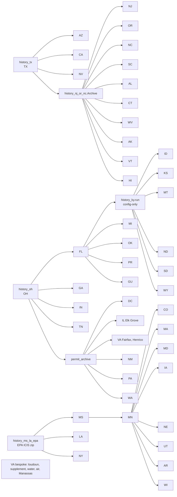

# How the per-jurisdiction collectors relate

Every collector does the same five things. They differ in the source adapter (step 2) and in how much of steps
1, 3 and 5 they borrowed versus rewrote.

| Step | What it does | Shared today | Rewritten per family |
|---|---|---|---|
| 1. Fetch | HTTP GET, retry, user agent, robots/crawl delay | `collect.policy` (robots, delay), called from 17 collector files | 27 separate GET helpers, 9 user-agent strings; `requests` and system `curl` in 4 |
| 2. Adapt | Query the publisher's register: ArcGIS, Socrata, Accela, CKAN, Legistar, PDF/OCR, EPA ICIS zip | EPA ICIS (`history_ms_la_epa`, one national zip sliced for 10 states) | ArcGIS object-ID paging in ~25 files |
| 3. Pin | Save bytes, SHA-256, manifest; replay offline | `permit_archive.Archive` (URL-keyed, content-addressed), `history_nj_or_nc.Archive` (name-keyed), `history_fl.Store` | sha/dump helpers re-declared in 9 files |
| 4. Extract | Turn source rows into interchange records; quote-match evidence | Interchange schema enforced in `build_history.py` | Record construction (`rec`, `row`, `fc`, `reviewed`...) per family |
| 5. Rank and audit | Point-in-polygon of IM3 markers into Census places; validation JSON | `history_tx.places/contains`, `Archive.rank`, `permit_archive.place_rank` | 5 ranking implementations |
| Status | Map register status to active / historical / unconfirmed | `permit_status.py` dispatch; `status_ms.epa` reused by 23 state modules | One `status_<st>.py` per state |

## Families (who copied whom)

| Family | Root | Jurisdictions | Character |
|---|---|---|---|
| Config-only adapter | `history_ky.run(state, fips)` | KY, ID, KS, MT, ND, SD, WY | A 2-line script; sources and reviewed records live in `data/history/<state folder>/config.json`. Each record carries a quote that must appear on the cited page. The most transferable pattern. |
| Texas lineage | `history_tx` → `history_nj_or_nc.Archive` | TX, AZ, CA, NV, NJ, OR, NC, SC, AL, CT, WV, AK, VT, HI | Name-keyed archive with `refresh()`/`build()` split, Census place geometry and IM3 ranking built in. |
| Ohio lineage | `history_oh` → `history_fl.Store` | OH, FL, GA, IN, TN, MI, OK, PR, GU | ArcGIS layer pulls and Accela portal detail pages; manifest of layers; `--fetch`. |
| EPA lineage | `history_ms_la_epa` → `history_ms` → `history_mn` | MS, LA, MN, CO, MA, MD, IA, NE, UT, AR, WI, NY | State register plus EPA ICIS-NPDES join; `reconcile()` suppresses exact permit+day duplicates; gzip-pack helpers; `--refresh` via `sys.argv`. |
| URL-keyed archive | `permit_archive.Archive` | DC, IL, PA, WA, NM, VA (Fairfax, Henrico), federal and council collectors | Content-addressed cache keyed by URL; refuses unarchived URLs offline; uses `collect.policy`. Cleanest store. |
| Virginia originals | bespoke | VA (Loudoun, supplement, DEQ water, air, Manassas) | First collectors; config files per layer, own manifests. |
| National | `federal_*`, `municipal_*`, `council_*`, `casebook`, `history_cases` | Write series for many states at once | Refreshing one state reruns all states they cover. |

## Shared modules (added November 16, 2026)

**`scripts/fetch.py`**: one GET for live collectors. It checks robots.txt (RFC 9309: a 4xx robots file means no rules;
a 5xx or unreachable one means do not fetch), spaces requests per host and honors crawl delays up to 30 seconds. It also
retries network errors and 429/5xx responses, caps response size, uses one user agent, and offers optional `curl`
transport for servers whose TLS urllib can't negotiate. `ROBOTS_EXEMPT` lists the only bypass, with a reason
(raw.githubusercontent.com, for the pinned IM3 atlas file). Collectors import it as `netfetch`, because several
already define a function named `fetch`.

**`scripts/arcgis.py`**: `pull(get, read, url, where, fields)` fetches a layer in object-ID slices. Each slice must
return exactly the IDs requested, with no `exceededTransferLimit`. `records(read, pulled)` re-proves completeness from
the archive offline. Callers keep their own storage: they pass `get` and `read`, and the query parameter order is
fixed, so the same query yields the same URL and archive key.

Now on the shared modules (each family inherits from its root):

| Root migrated | GET | ArcGIS paging | Jurisdictions that inherit it |
|---|---|---|---|
| `history_tx.req` | yes | - | TX, AZ, CA, NV and the `history_nj_or_nc` group (NJ OR NC SC AL CT WV AK VT HI) |
| `history_oh.get/pull/records` | yes | yes | OH |
| `history_fl.Store.get/arcstore` | yes | yes | FL, MI, OK, PR, GU, and the config-only group (KY ID KS MT ND SD WY) |
| `history_mn.get/arc` | yes | yes | MN and the descendants that use them (CO MA MD IA NE UT AR WI) |
| `permit_archive.Archive.get` | yes | - | DC, IL, PA, WA, NM, VA Fairfax/Henrico, federal and council collectors |
| `history_la_sources.download` | yes | - | LA |

**Refresh semantics fixed.** About a dozen collectors only fetched sources that weren't archived yet, so `--fetch`
never re-pulled a cached page. These are `permit_archive`, `history_fl`/`ky`/`mi`/`ok`/`pr`/`ga`/`in`/`tn` (and
`federal_corps` and `westmetro`, which still behave this way). The migrated ones now honor `ATLAS_REFETCH=1`, which
`jurisdiction.py refresh` sets. `--gap-fill-only` keeps the old behavior. Content-addressed archives keep the old bytes.
The name-keyed `history_nj_or_nc.Archive` overwrites them, which is the main reason to fold it into
`permit_archive` next.

Live verification: `refresh` passed for CT (Texas lineage), WY (config-only), MN (EPA lineage) and DC (URL-keyed
archive). CT and WY re-pulled pages whose bytes had changed, with no change to records. In DC, the city's GIS feed
renumbered every OBJECTID, so the record links (built from OBJECTID) changed. Those links should be built from
`PERMIT_ID` instead.

## Migration status (November 16, 2026, second pass)

- **HTTP:** every collector now downloads through `netfetch` (`fetch.py`); no direct `urlopen`, `requests` or `curl`
  calls remain in collectors. `fetch.request()` handles form and JSON POSTs and returns the final URL and MIME type;
  `fetch.Session` keeps cookies for ASP.NET search pages (Vermont); `transport='curl'` (with robots.txt read over
  curl) covers two servers whose TLS urllib can't negotiate; `fetch.download()` streams the EPA national ZIP;
  `fetch.wire()` escapes spaces in links such as Vermont's ANR PDFs.
- **ArcGIS:** 15 pagers use `arcgis.pull`, including GA, TN, NC, NV, NE, DC, Loudoun (both), Fairfax, San Jose,
  Fort Worth and the Loudoun/Phoenix water-fire queries. `id_params`, `page_params` and `sort` keep each
  collector's URLs byte-identical; DC and Fairfax archives are keyed by URL and still replay offline, which proves it.
  Not migrated: AZ's Maricopa air query (deliberately `WHERE … IN (…)`), and six one-shot ID lookups that check a
  boundary query is complete rather than page through a layer.
- **Verified:** `check --all` passes for 55 of 55; unit tests pass; live `refresh` passed for CT, WY, MN, DC, VT, NC
  and AR. `refresh` now also fails closed if one jurisdiction's refresh changes another's records
  (`--allow-sibling-writes` to accept).
- **Next:** the folder layout and naming in [plan-collector-layout.md](plan-collector-layout.md).

Live-mode flags are inconsistent (`--refresh`, `--fetch`, `--fetch-lincoln`, `--city`, none). The registry normalizes
them so `make refresh-XX` works without editing collectors; unifying the flag is a cleanup, not a blocker.
